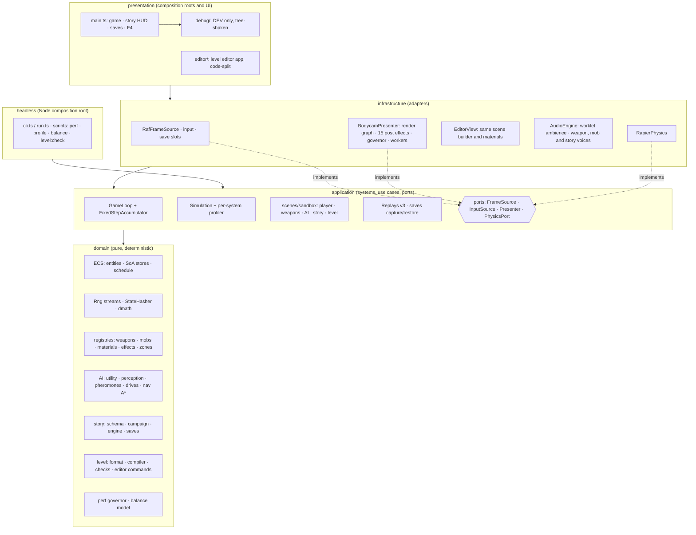
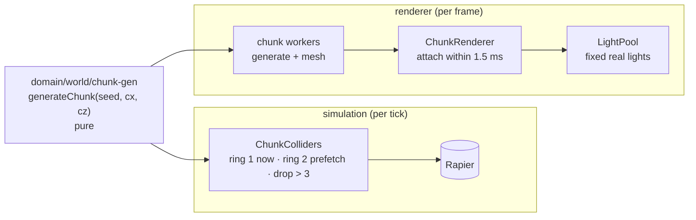

# Architecture

## Frame flow

1. `RafFrameSource` delivers a wall-clock timestamp (the only clock in the game).
2. `GameLoop` feeds the delta to `FixedStepAccumulator` → N fixed 60 Hz steps.
3. For each step: `InputSource.commandsFor(tick)` → `Simulation.step(commands)` → systems run in
   schedule order on a reused `SimContext` (world, RNG streams, tick, dt, commands).
4. `Presenter.present(alpha)` draws, interpolating between the last two ticks.

Replays record exactly the per-tick commands from step 3, so playback in Node reproduces the run.

## Open world streaming (ADR-0010)

Both sides derive chunk content from the seed alone. The simulation streams around the player's
feet on ticks, so replays reproduce it. The renderer streams around the camera on frames, so it
never touches the state hash.

## Folder map

| Path                         | Contents                                                                                                                                                            |
| ---------------------------- | ------------------------------------------------------------------------------------------------------------------------------------------------------------------- |
| `src/domain/core`            | Branded types (`Seed`, `Tick`), `assertNever`, `invariant`                                                                                                          |
| `src/domain/math`            | `Rng`/`RngStreams`, `StateHasher`, deterministic `dmath`                                                                                                            |
| `src/domain/ecs`             | `EntityAllocator`, `ComponentStore`, `World`, `buildSchedule`                                                                                                       |
| `src/domain/input`           | `InputCommand` discriminated union + Zod schema                                                                                                                     |
| `src/domain/procgen`         | Tileable noise, material recipe registry, texture baker                                                                                                             |
| `src/domain/bodycam`         | Bodycam effect registry, gameplay stimulus modulation                                                                                                               |
| `src/domain/world`           | World map (hubs, roads), chunk grid + generator, clock/weather, street & range layouts                                                                              |
| `src/infrastructure/render`  | WebGL presenter, render graph, post pipeline, effects, scene; `world/`: chunk workers, streaming, light pool, sky, rain; `mobs/`: procedural mob models, AI overlay |
| `src/application`            | `Simulation`, `loop/`, `replay/`, `scenes/`; `world/`: collider streaming, environment system                                                                       |
| `src/infrastructure/browser` | rAF frame source, keyboard/mouse and touch input                                                                                                                    |
| `src/presentation`           | Browser composition root, OSD, `debug/`                                                                                                                             |
| `src/headless`               | Node runner and CLI                                                                                                                                                 |
| `tests/golden`               | Golden hashes and replay files                                                                                                                                      |
| `tests/fixtures`             | Test-only worlds (e.g. the churn stress world)                                                                                                                      |
| `eslint/architecture.js`     | Layer and determinism lint rules                                                                                                                                    |
| `scripts/`                   | Perf gate, bundle check                                                                                                                                             |
| `docs/adr`                   | Architecture decision records                                                                                                                                       |

## Stages 8–10 at a glance

- **Story** (ADR-0014). Data in `domain/story`, a pure engine and the `story.step` system. Notes go
  out on the `story` event channel to the HUD, the radio voices and the autosave. Saves are
  progress checkpoints with migrations, and replays can start from one.
- **Levels** (ADR-0015). A level compiles to the same `StreetLayout` every scene uses. The
  editor's commands, brushes and checks are pure domain code. "Play from here" is
  `createLevelSandbox`.
- **Polish** (ADR-0016). The governor scales quality in the presenter. `Simulation.setProfiler`
  times systems with an outside clock. `domain/balance` turns the registries into a balance
  sheet with design targets as tests.
