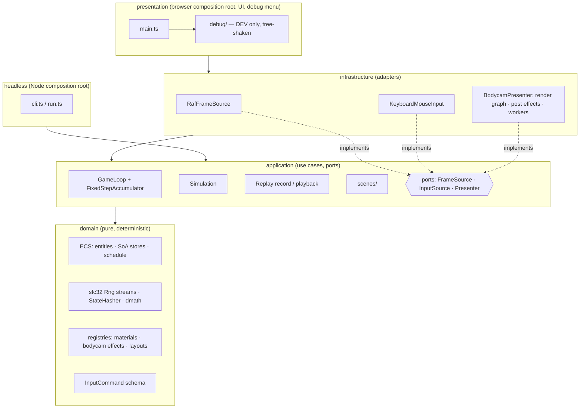

# Architecture

## Frame flow

1. `RafFrameSource` delivers a wall-clock timestamp (the only clock in the game).
2. `GameLoop` feeds the delta to `FixedStepAccumulator` → N fixed 60 Hz steps.
3. For each step: `InputSource.commandsFor(tick)` → `Simulation.step(commands)` → systems run in
   schedule order on a reused `SimContext` (world, RNG streams, tick, dt, commands).
4. `Presenter.present(alpha)` draws, interpolating between the last two ticks.

Replays record exactly the per-tick commands from step 3, so playback in Node reproduces the run.

## Folder map

| Path                         | Contents                                                      |
| ---------------------------- | ------------------------------------------------------------- |
| `src/domain/core`            | Branded types (`Seed`, `Tick`), `assertNever`, `invariant`    |
| `src/domain/math`            | `Rng`/`RngStreams`, `StateHasher`, deterministic `dmath`      |
| `src/domain/ecs`             | `EntityAllocator`, `ComponentStore`, `World`, `buildSchedule` |
| `src/domain/input`           | `InputCommand` discriminated union + Zod schema               |
| `src/domain/procgen`         | Tileable noise, material recipe registry, texture baker       |
| `src/domain/bodycam`         | Bodycam effect registry, gameplay stimulus modulation         |
| `src/domain/world`           | Street layout generator (shared by render, later physics/nav) |
| `src/infrastructure/render`  | WebGL presenter, render graph, post pipeline, effects, scene  |
| `src/application`            | `Simulation`, `loop/`, `replay/`, `scenes/`                   |
| `src/infrastructure/browser` | rAF frame source, keyboard/mouse input                        |
| `src/presentation`           | Browser composition root, OSD, `debug/`                       |
| `src/headless`               | Node runner and CLI                                           |
| `tests/golden`               | Golden hashes and replay files                                |
| `tests/fixtures`             | Test-only worlds (e.g. the churn stress world)                |
| `eslint/architecture.js`     | Layer and determinism lint rules                              |
| `scripts/`                   | Perf gate, bundle check                                       |
| `docs/adr`                   | Architecture decision records                                 |
